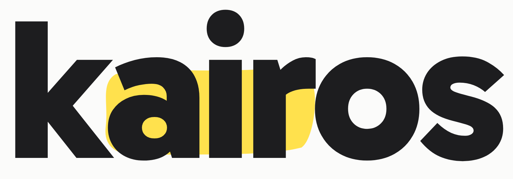

<p align="center">
  
</p>

# Kairos

Local-first Mac app for college students on Canvas. It reads your classes and shows the next move, the week around it, and a study path for what is coming.

**Works without a Canvas access token.** You sign in through your school the way you already do. Kairos never sees your password. It never submits, comments, or posts on Canvas for you.

Site: [kairostime-landing.vercel.app](https://kairostime-landing.vercel.app) · Source: [github.com/jacobdpfeifer-svg/Kairos_Time](https://github.com/jacobdpfeifer-svg/Kairos_Time)

## Repository map

| Path | Why it exists |
|------|----------------|
| [`app/`](app/) | Mac app (Tauri + React) and the Chrome extension that reads your Canvas session |
| [`browser/`](browser/) | School login, then Canvas `/api/v1` into a local inbox |
| [`landing/`](landing/) | The public site. Static files, deployed from this folder on Vercel |
| [`skills/`](skills/) | Playbooks the agent follows. The index is [`AGENTS.md`](AGENTS.md) |
| [`src/canvas_mcp/`](src/canvas_mcp/) | Optional token client. Vendored fork of [canvas-mcp](https://github.com/vishalsachdev/canvas-mcp) |
| [`plugins/`](plugins/) | School connectors, loaded only after onboarding discovers the school |
| [`design-system/kairos/MASTER.md`](design-system/kairos/MASTER.md) | Notebook, the visual system for the app, extension, and landing page |
| [`docs/architecture.md`](docs/architecture.md) | How login, inbox, and the app share one truth path |

The root `package.json` only builds the vendored TypeScript code API (`src/canvas_mcp/code_api`). The product to run is `app/`.

Per-student data (inbox, grades, tokens) stays on the machine under the app-support folder. It is not in this repository.

## For reviewers

1. This file, then [`AGENTS.md`](AGENTS.md) for what the agent may and may not do.
2. [`docs/architecture.md`](docs/architecture.md) for the data path.
3. [`design-system/kairos/MASTER.md`](design-system/kairos/MASTER.md) before judging UI. Notebook replaced earlier visual directions.
4. [`SECURITY.md`](SECURITY.md) for how to report a vulnerability.
5. [`landing/`](landing/) should match the product: Today, Week, Courses, Study, Advisor, any Canvas school, no invented testimonials.
6. Full pre-review sweep: [`skills/audit/SKILL.md`](skills/audit/SKILL.md) or paste from [`docs/audits/comprehensive-team-review-prompt.md`](docs/audits/comprehensive-team-review-prompt.md).

Upstream canvas-mcp history is in [`CHANGELOG.md`](CHANGELOG.md) on purpose. Kairos commit history starts at the product rename.

## Run the Mac app

```bash
uv sync
cd browser && npm ci && npx playwright install chromium && cd ..
scripts/dev-app.sh
```

That starts the native shell against the local `dev` profile (`~/Library/Application Support/Kairos/dev` on macOS). Canvas sign-in is a button inside the app.

UI only, without the native shell:

```bash
cd app && npm ci && npm run dev
```

## Sync Canvas without a token

```bash
cd browser
npm ci && npx playwright install chromium
npm run open-canvas   # you finish your school's login once
npm run sync          # writes {user_root}/inbox/week.md from /api/v1
```

The school comes from onboarding (`{user_root}/school/profile.json`). See [`docs/architecture/school-personalization.md`](docs/architecture/school-personalization.md). For development, set `SCHOOL_SLUG` to a file in [`schools/`](schools/) and optionally `DEV_USER_ROOT`. Without `DEV_USER_ROOT`, sync uses the same app-support path as the Mac app.

In chat, ask for a week plan, or "brief me" / "what should I do first".

## Optional access token

When a school issues a personal access token, the same REST data is available through `canvas-mcp-server`. It is a second client, not a second system. Notes live in [`docs/schools/`](docs/schools/) and [`vendor/README.md`](vendor/README.md).

## Landing page

[`landing/`](landing/) has no build step. [`landing/config.js`](landing/config.js) is the launch switch: the Mac download stays off until `downloadUrl` points at a signed `.dmg`. The source button points at this repository.

## What Kairos will not do

No instructor tools, no quiz taking, no student-portal or DegreeWorks scraping, no RateMyProfessors. GPA math and course suggestions stay on the machine. A claim that a degree requirement is satisfied has to come from an audit the student pasted from their own portal.

## License

MIT. Upstream canvas-mcp copyright stays in [`LICENSE`](LICENSE).
